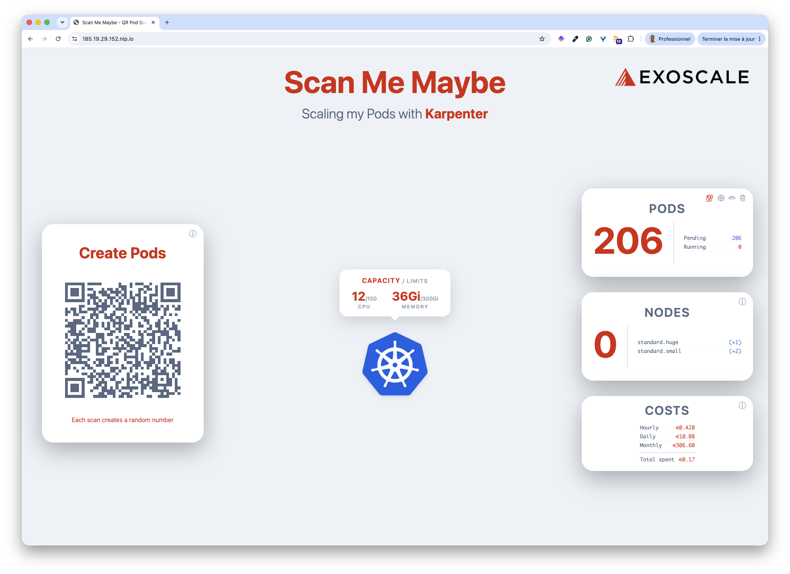
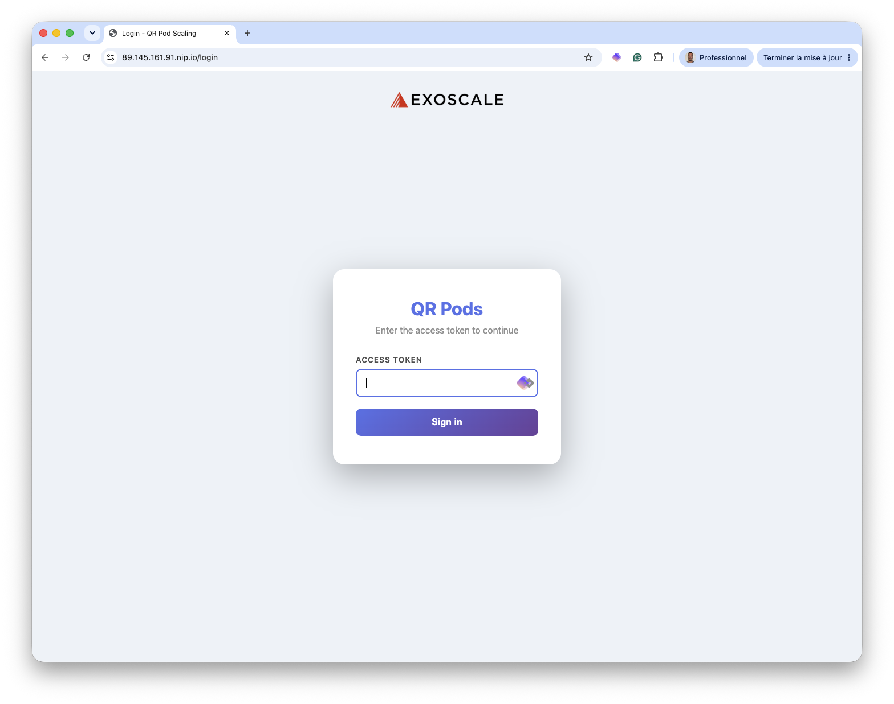
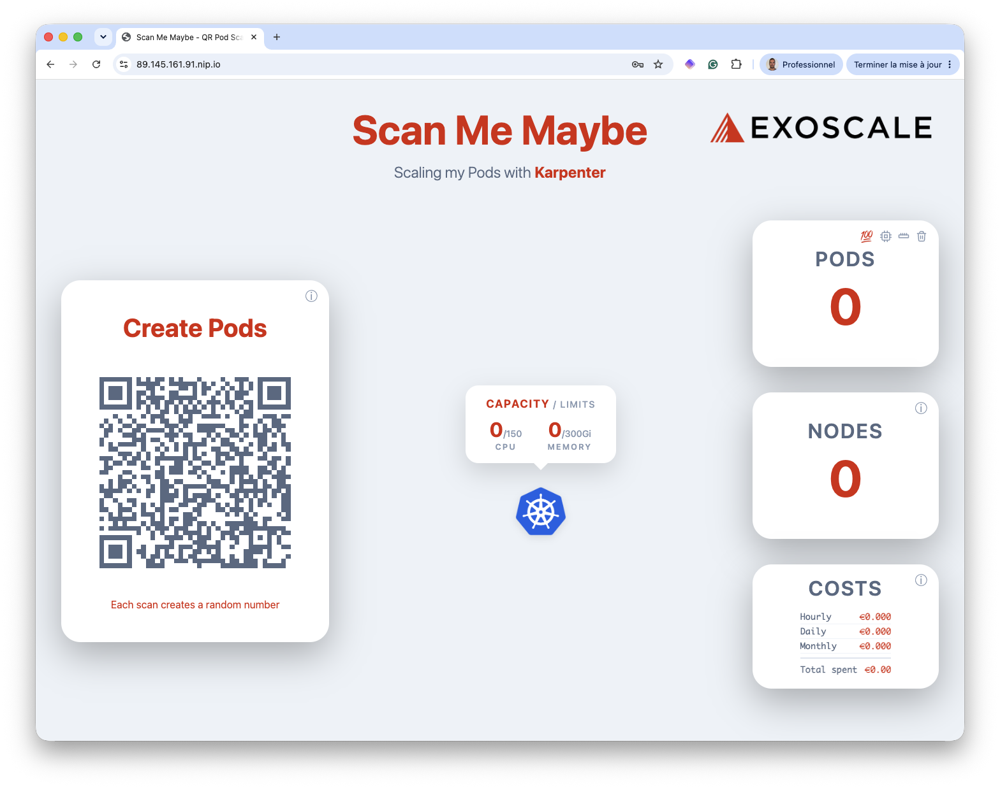
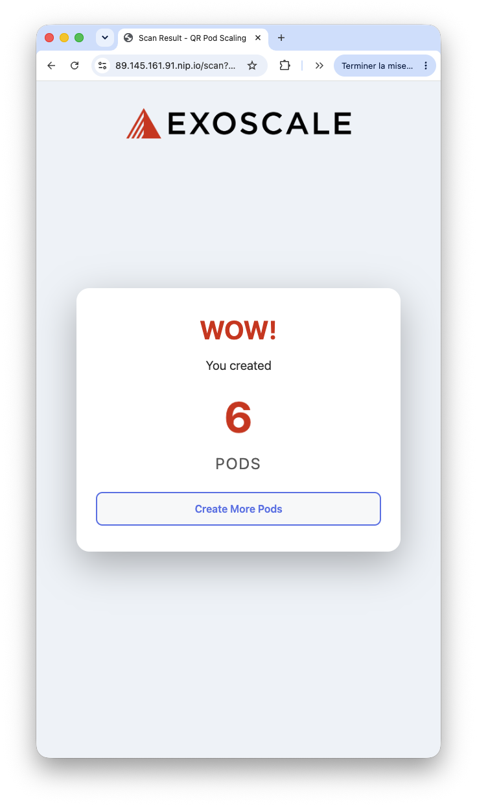
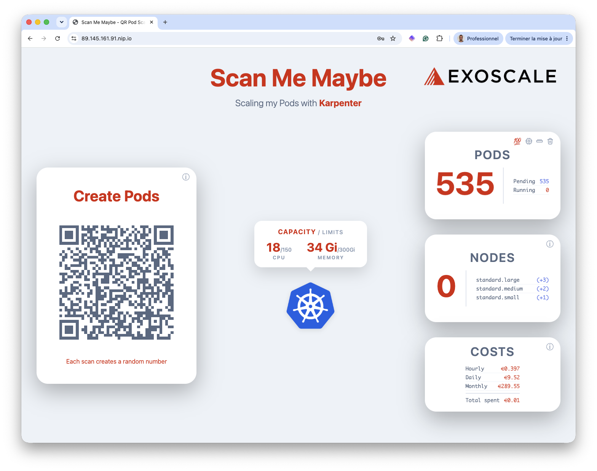
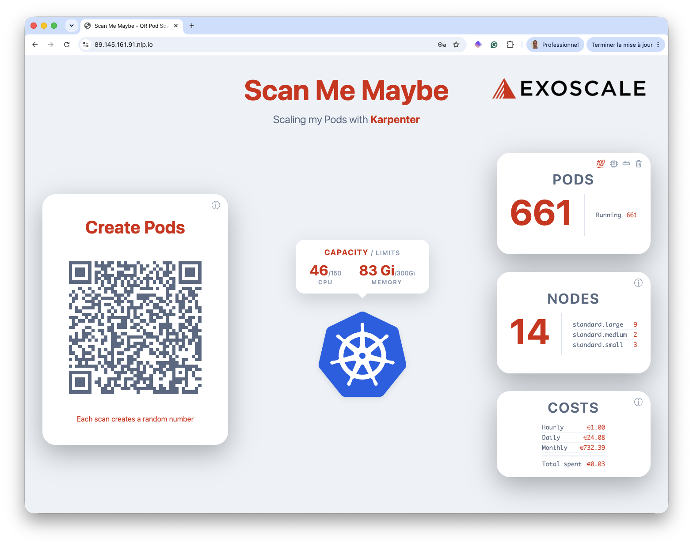
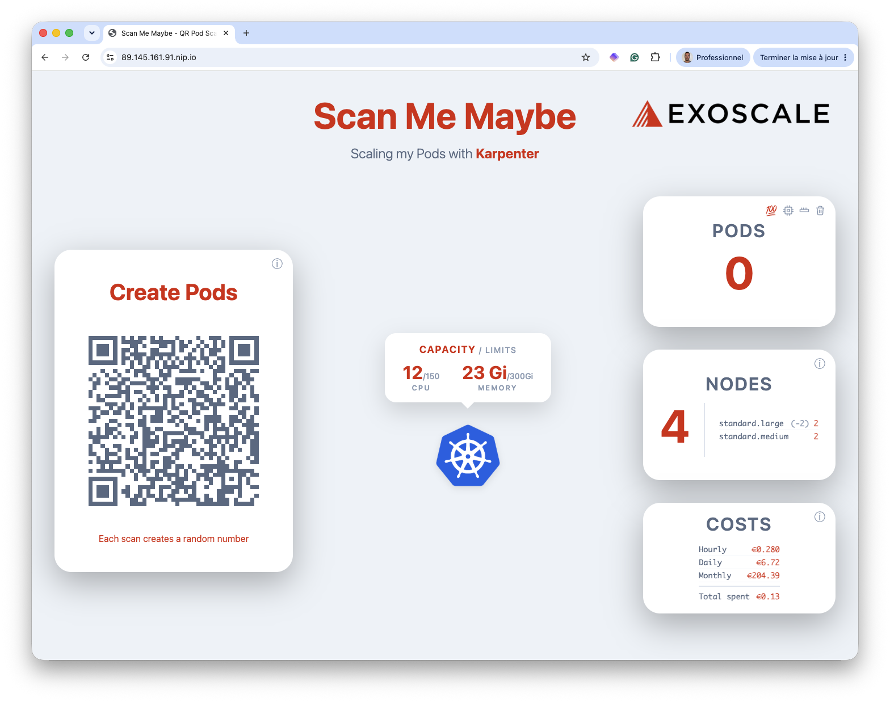

## Scan Me Maybe: QR Code Driven Pod Scaling With Karpenter

Exoscale is the first European cloud provider to offer fully integrated Karpenter autoscaling for managed Kubernetes. This repo contains a demo application, that should be deployed on an Exoscale-managed Kubernetes, illustrating the Karpenter capabilities.



When participants scan the QR code with their phones, it creates 1-10 random pods, and shows the evolution of th number of nodes in the cluster. Perfect for presentations and demos showcasing Karpenter node autoscaling :).

## Features

- **Big Screen Display**: shows QR code, live visualization, pod count, and node count
- **Mobile Result Page**: participants see "WOW! You created X Pods" after scanning
- **Real-time Updates**: metrics update every couple of seconds

## Architecture

- **Backend:** Python/Flask with Kubernetes Python client
- **Frontend:** HTML/CSS/JavaScript with QRCode.js
- **Two Pages:**
  - `/` - Big screen display with QR code and live metrics
  - `/scan?token=X` - Mobile result page after scanning

## Setup

- Prerequisites

  Install [helmfile](https://github.com/helmfile/helmfile), a very useful tool to install helm chart in a declarative waY.

- Create an SKS cluster with a default nodepool with 2 medium nodes.

- Get the kubeconfig and copy it in ./kubeconfig

- Get the ID of the security group

- Copy this ID in the **./infra/nodeclass.yaml** specification

```yaml
apiVersion: karpenter.exoscale.com/v1
kind: ExoscaleNodeClass
metadata:
  name: standard
spec:
  imageTemplateSelector:
    version: "1.37.0"
  securityGroupSelectorTerms:
    - id: "REPLACE_WITH_YOUR_SECURITY_GROUP_ID"
```

- create the *ExoscaleNodeClass* resource

```bash
kubectl apply -f ./infra/nodeclass.yaml
```

- create the Karpenter *NodePool* resource

```bash
kubectl apply -f ./infra/nodepool.yaml
```

- Deploy Traefik

```bash
helmfile -f ./infra/helmfile.yaml.gotmpl -l app=traefik apply
```

- Get external IP address

Note: you may need to wait a few tens of seconds before it is available

```bash
EXTERNAL_IP=$(kubectl get svc -n traefik -o jsonpath='{.items[0].status.loadBalancer.ingress[0].ip}')
```

- Deploy cert-manager

Note: you first need to replace the placeholder with your email in *infra/helmfile.yaml.gotmpl*.

```yaml
...
spec:
  acme:
    server: https://acme-v02.api.letsencrypt.org/directory
    email: REPLACE_WITH_YOUR_EMAIL      <--
    privateKeySecretRef:
      name: letsencrypt-key
    solvers:
      - http01:
          ingress:
            class: traefik
```

```bash
helmfile -f ./infra/helmfile.yaml.gotmpl -l app=cert-manager apply
```

- Set the following env vars (they will be used when deploying the app with Helmfile)

  * SCAN_TOKEN: authenticate scans
  * DASHBOARD_PASSWORD: access to the dashboard
  * SECRET_KEY: used by Flask to signe the session

- Deploy the application

```bash
DOMAIN="$EXTERNAL_IP.nip.io"
helmfile -f ./infra/helmfile.yaml.gotmpl -l app=qrpods apply --set app.url="$DOMAIN"
```

## Access the application

The dashboard is available at *https://$DOMAIN.nip.io* 



Once we're logged in, we cannot see any Pod nor Node as we haven't created any Pod yet.



This is an example of the QR Code scanned.



If the QR code is sanned a lot, then it triggers the creation of several Karpenter Nodes.



It takes a few tens of seconds for the Nodes to be created and the Pods to be scheduled on them. 



The Pods are automatically deleted after 5 minutes. It takes a couple of minutes for the Karpenter Nodes to be removed.



## Cleanup

```bash
# Delete created demo pods
kubectl delete deploy -l app=qrpods

# Remove application (Helm)
helmfile -f ./infra/helmfile.yaml.gotmpl -l app=qrpods destroy
```

## License

MIT